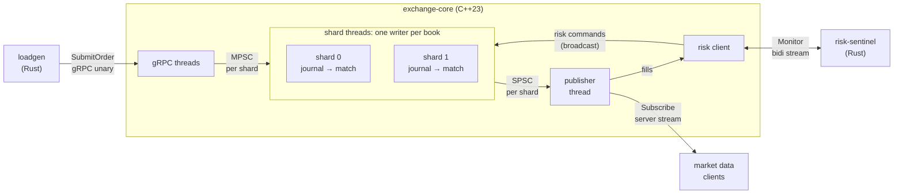

# Lockstep

[](https://github.com/Tomek52/lockstep-exchange/actions/workflows/ci.yml)

**A deterministic, lock-free exchange engine in C++23, with a Rust risk sentinel.
Every state replays in lockstep.**

Lockstep is a small exchange simulator built as an architecture showcase:

- **exchange-core** (C++23) accepts orders over gRPC, matches them per
  instrument with price-time priority, publishes market data, and journals
  every input so that replaying the journal reproduces the exact same state
  and outputs.
- **risk-sentinel** (Rust, tokio + tonic) watches executions over a
  bidirectional gRPC stream, tracks positions and PnL, and pushes risk
  commands back: block a trader, or pull the kill switch.
- **loadgen** (Rust) drives order flow and reports p50/p99/p99.9 latency.

What this repository is meant to demonstrate, in order of importance:

1. **Software architecture.** Hexagonal layers whose dependency rules are
   *enforced by the build*. A single-writer threading model. Deterministic
   replay as a tested property. Every significant decision recorded as an
   [ADR](docs/adr/README.md).
2. **Modern C++ used where it fits.** `std::expected`, `std::flat_map` (with a
   probed fallback), `std::generator`, deducing `this`,
   `std::move_only_function`, `std::print`, ranges, `std::stacktrace`,
   `if consteval` and concepts. Each is used where it removes code or a bug
   class ([ADR-0009](docs/adr/0009-toolchain-baseline-and-feature-fallbacks.md)).
3. **A disciplined workflow for coding with LLMs.** Self-contained task
   specs, tests first, machine-checked guardrails, human review
   ([docs/ai-workflow.md](docs/ai-workflow.md), [CLAUDE.md](CLAUDE.md)).

## Architecture at a glance



- **Single writer per order book.** Instruments are sharded across threads;
  each book is mutated by exactly one thread, so the domain has no locks
  ([ADR-0003](docs/adr/0003-single-writer-sharding.md)).
- **Write-ahead journal per shard.** Commands, including their timestamps and
  the risk commands, are journaled before they are applied, and outputs are
  released only after commit
  ([ADR-0004](docs/adr/0004-deterministic-replay-via-per-shard-journal.md)).
- **Pure domain.** Standard library only: no clocks, threads, I/O or gRPC.
  Checked at configure time (link allow-lists) and test time (include
  fitness functions)
  ([ADR-0002](docs/adr/0002-hexagonal-architecture-enforced-by-the-build.md)).
- **Fixed-point money.** Integer ticks and lots as strong types
  ([ADR-0005](docs/adr/0005-fixed-point-prices-and-quantities.md)).

More: [C4 context](docs/architecture/c4-context.md) ·
[containers and components](docs/architecture/c4-container.md) ·
[threading and data flow](docs/architecture/threading-dataflow.md) ·
[domain model](docs/architecture/domain-model.md).

## Quick start

Requires Ubuntu 24.04 (native, WSL2, or a container). On Windows, clone the
repository inside the WSL filesystem, not under `/mnt/c`.

```bash
scripts/setup-ubuntu.sh                 # ~3 min on a fresh Ubuntu 24.04: GCC 14, Clang 19, gRPC, protobuf, GTest, Benchmark, buf, Rust

# C++: build and test (presets: debug, release, clang-debug, asan-ubsan, tsan)
cmake --workflow --preset debug
cmake --workflow --preset tsan

# Rust
(cd rust && cargo test && cargo build)

# End-to-end: risk-sentinel + exchange-core + loadgen as separate processes
scripts/e2e-smoke.sh
scripts/e2e-kill-switch.sh              # the risk loop: block, kill switch, replay

# Or the whole stack in containers
docker compose -f deploy/docker-compose.yml up --build -d --wait
docker compose -f deploy/docker-compose.yml --profile load run --rm loadgen
docker compose -f deploy/docker-compose.yml down
```

Run a service by hand:

```bash
rust/target/debug/risk-sentinel --listen 127.0.0.1:50052
build/debug/exchange-core/main/exchange-core --listen=127.0.0.1:50051 --risk-sentinel=127.0.0.1:50052
rust/target/debug/loadgen --target http://127.0.0.1:50051 --count 100 --instrument 2
```

Restarting with the same `--journal-dir` (including `docker compose stop`
followed by `start`) recovers and resumes each shard's existing journal
(ADR-0020, task 010) instead of failing on `O_EXCL`; a journal `recover_tail`
cannot safely repair stops startup naming the file instead. To inspect a
journal, run `build/debug/exchange-core/main/journal-dump <dir>/shard-0.jnl`,
or `build/debug/exchange-core/main/lockstep-replay --journal-dir=<dir>
--shards=N --instruments=...` for a per-shard digest of the whole directory.

## See the risk loop in action

`scripts/e2e-kill-switch.sh` starts risk-sentinel (tight limits) and
exchange-core (with a journal), then drives them with loadgen:

1. trader 666 buys until it breaches the position limit and is **blocked**
   (`TRADER_BLOCKED`), while four other traders keep getting accepts;
2. a falling market of many moderate losses, none near the per-trader limit,
   pushes the **gross loss** over the kill-switch limit
   ([ADR-0021](docs/adr/0021-sentinel-kill-switch-on-gross-loss.md)); from then
   on every order from every trader on every instrument gets `TRADING_HALTED`;
3. after stopping exchange-core, `lockstep-replay` over the journals gives the
   same digests as the live run, so every rejection is reproduced exactly, and
   `journal-dump` shows the `BlockTrader` and `KillSwitch` commands on both
   shards.

```bash
cmake --build --preset debug --target exchange-core lockstep-replay journal-dump
(cd rust && cargo build)
scripts/e2e-kill-switch.sh
```

An excerpt of its output (WSL2 laptop, debug build; the numbers vary):

```text
==> sentinel sent BlockTrader for 666 and the exchange applied it
    ... risk command sent command_id=1 action=BlockTrader { trader: 666, reason: "net position 2100 > 2000 on instrument 2" }
    ... risk command applied by exchange command_id=1 latency_us=3208 action=BlockTrader { trader: 666, ... }
==> sentinel engaged the kill switch and the exchange applied it on every shard
    ... risk command sent command_id=3 action=KillSwitch { engaged: true, reason: "gross loss 106256 > 100000 (kill switch)" }
    ... risk command applied by exchange command_id=3 latency_us=8808 action=KillSwitch { engaged: true, ... }
==> lockstep-replay digest vs --print-digest-on-exit
    exchange-core:   shard 0: 284 commands, 744 events, digest=0xc4d67bc142518e2b
    lockstep-replay: shard 0: 284 commands, 744 events, digest=0xc4d67bc142518e2b
==> scenario timeline
    time to block (first fill -> TRADER_BLOCKED, breach):  169701 us
    time to halt  (first fill -> TRADING_HALTED, loss):    283282 us (33 fills)
    rejected orders by reason, all loadgen runs:
      REJECT_REASON_TRADER_BLOCKED     1
      REJECT_REASON_TRADING_HALTED     25
      REJECT_REASON_UNKNOWN_ORDER      18
E2E KILL-SWITCH PASSED
```

The two "time to" figures are measured by loadgen from the first accepted fill
of the scenario to the first rejection, so they include the scenario's own
rounds of orders (21 for the block, 33 for the halt), not only the latency of
the sentinel loop. The sentinel's own send-to-applied latency is the
`latency_us` in its log (a few milliseconds here).

## Repository layout

```
proto/lockstep/v1/        gRPC contracts shared by both builds (buf-linted)
exchange-core/
  domain/                 pure business logic: types, order book, shard engine
  concurrency/            queue concepts, lock-free queues, idle strategies
  app/                    ports + runtime (Engine, ShardRuntime, Publisher, replay)
  adapters/{grpc,codec,journal,risk_client}/
  main/                   composition root
  tests/<layer>/          one test executable per layer + architecture rules
  bench/  fuzz/
rust/crates/{lockstep-proto,risk-sentinel,lockstep-loadgen}/
deploy/                   Dockerfiles, docker-compose.yml
scripts/                  setup, format, clang-tidy, proto and docs checks, e2e
docs/{architecture,adr,tasks}/, docs/ai-workflow.md
CLAUDE.md                 rules for AI agents in this repo
ROADMAP.md                milestones → task specs
```

## Project status

**Milestone M0 (walking skeleton) is complete.** What works today:

| Area | Status |
|---|---|
| Build: CMake presets (debug, release, clang-debug, asan-ubsan, tsan), feature probe, architecture rules | ✅ |
| CI: C++ on 5 presets, clang-tidy, fuzzing, Rust, proto checks, e2e, Docker | ✅ all 11 jobs green on GitHub Actions |
| Contracts: `lockstep.v1` protos, codegen in CMake and `build.rs` | ✅ |
| Domain: strong types, validation, pooled order book with O(1) cancel, price-time matching, modify (cancel/replace), duplicate client order id rejection, and risk controls (block, kill switch, link policy) | ✅ |
| Runtime: shards + publisher on `std::jthread`, write-ahead ordering, lossless shutdown | ✅ lock-free SPSC egress ([task 005](docs/tasks/005-spsc-queue.md)) and MPSC ingress ([task 006](docs/tasks/006-mpsc-queue.md)); threads park on a `Doorbell` instead of polling, with runtime stats exposed ([task 007](docs/tasks/007-runtime-idle-and-stats.md)); runtime subscriptions with filtering and a slow-consumer policy ([task 011](docs/tasks/011-publisher-fanout.md)) |
| Order entry over gRPC, end to end | ✅ |
| Risk loop: handshake, inbound commands, execution reports, ack aggregation across shards, heartbeats, reconnect with back-off | ✅ ([task 014](docs/tasks/014-risk-client-adapter.md)) |
| Write-ahead journal on disk: one file per shard, CRC32C-checked records, `--journal-dir`, `--fsync=none\|commit` | ✅ writer ([task 008](docs/tasks/008-journal-writer.md)); lazy `std::generator` reader, torn-tail recovery, `journal-dump` and a decoder fuzzer ([task 009](docs/tasks/009-journal-reader.md)); recover/replay/resume a restart and a `lockstep-replay` digest tool ([task 010](docs/tasks/010-deterministic-replay.md), [ADR-0020](docs/adr/0020-journal-restart-recover-replay-resume.md)) |
| Deterministic replay test (live vs replay, in memory and on disk, crash recovery, restart) | ✅ ([task 010](docs/tasks/010-deterministic-replay.md)) |
| Market data stream: `MarketDataService.Subscribe` with instrument and kind filters, slow consumers disconnected with `RESOURCE_EXHAUSTED` | ✅ ([task 013](docs/tasks/013-grpc-market-data.md)) |
| risk-sentinel position/limit engine and Monitor session | ✅ pure positions, PnL and limits ([task 015](docs/tasks/015-sentinel-positions-pnl.md)); execution reports decoded, deduplicated across reconnects by `(shard, sequence, trade index, maker)` so every trade of a sweeping order counts ([task 021](docs/tasks/021-execution-report-trade-index.md), [ADR-0022](docs/adr/0022-execution-report-trade-index.md)), risk commands with unique ids, heartbeats and idle timeout, limits as CLI flags ([task 016](docs/tasks/016-sentinel-monitor-service.md)) |
| End-to-end risk loop across processes: breach → block → kill switch on gross loss → `TRADING_HALTED` for everyone → replay digests equal, in CI | ✅ ([task 019](docs/tasks/019-e2e-kill-switch.md), [ADR-0021](docs/adr/0021-sentinel-kill-switch-on-gross-loss.md)) |
| Benchmarks: matching, queues and in-process engine round trip with p50/p99/p99.9, `scripts/run-benchmarks.sh` | ✅ ([task 018](docs/tasks/018-benchmarks.md), results below) |
| Load generator: `random` / `breach` / `loss` / `single` scenarios, `--concurrency`, `--rate`, seeded order flow, text and `--json` reports with p50-p99.9, back-pressure retries | ✅ ([task 017](docs/tasks/017-loadgen.md)) |

Verified locally on the skeleton (WSL2, Ubuntu 24.04):
- all C++ tests on debug, clang-debug, asan-ubsan and tsan;
- clang-tidy clean;
- cargo fmt, clippy (`-D warnings`) and tests;
- buf lint;
- the e2e smoke test;
- the compose stack (200/200 orders accepted).

GitHub Actions: all 11 jobs passed on the first run after publishing (run 36348820151).

## Benchmark results

Produced by [task 018](docs/tasks/018-benchmarks.md) with `scripts/run-benchmarks.sh`
(release preset, no gRPC, no CI). Every cell is the **median over 5 repetitions**
of that repetition's own percentile; each command or operation is timed
individually, so the percentiles are over thousands (the `fsync` row: 2 000)
to hundreds of thousands of samples (see the sources in `exchange-core/bench/`).

- Machine: 11th Gen Intel Core i7-1185G7 (4 cores / 8 threads), laptop, 16 GB,
  Linux 6.18 under **WSL2** (Ubuntu 24.04), GCC 14.2, `-O3`. Not an isolated
  or tuned machine: no CPU governor control, no `isolcpus`.
- Command: `scripts/run-benchmarks.sh` (threads not pinned), started when the
  1-minute load average was 0.31.
- Git commit: `8af7610` (base of the task 018 branch) plus the benchmark
  sources and script added by task 018. Raw JSON, with mean, stddev and cv per
  counter, plus the machine description, is written to `build/bench-results/`.

| Benchmark | p50 | p99 | p99.9 | Throughput |
|---|---|---|---|---|
| **Matching** (domain only, 1 thread, `ShardEngine::apply`) | | | | |
| rest one order + cancel the oldest, ~1 000 resting | 66 ns | 150 ns | 300 ns | 14.3 M cmd/s |
| aggressive fill, taker sweeps 1 level | 59 ns | 116 ns | 152 ns | 16.0 M cmd/s |
| aggressive fill, taker sweeps 3 levels | 120 ns | 280 ns | 447 ns | 7.2 M cmd/s |
| aggressive fill, taker sweeps 5 levels | 184 ns | 452 ns | 661 ns | 4.9 M cmd/s |
| mixed flow (seeded: limit, IOC, market, cancel, modify; 4 instruments) | 114 ns | 279 ns | 634 ns | 7.9 M cmd/s |
| **Queues** (round trip = two hops between two threads) | | | | |
| ping-pong, `MutexQueue` | 1.02 µs | 2.16 µs | 33.48 µs |  |
| ping-pong, `SpscQueue` | 172 ns | 213 ns | 895 ns |  |
| ping-pong, `MpscQueue` | 201 ns | 221 ns | 1.11 µs |  |
| **Queues, contended** (p50/p99/p99.9 = latency of one enqueue; throughput = items/s into one consumer) | | | | |
| `MpscQueue`, 1 producer | 28 ns | 76 ns | 85 ns | 20.8 M/s |
| `MpscQueue`, 2 producers | 79 ns | 484 ns | 1.10 µs | 13.9 M/s |
| `MpscQueue`, 4 producers | 196 ns | 1.41 µs | 2.79 µs | 11.6 M/s |
| `MutexQueue`, 1 producer | 44 ns | 1.13 µs | 16.67 µs | 3.7 M/s |
| `MutexQueue`, 2 producers | 29 ns | 1.66 µs | 27.14 µs | 7.2 M/s |
| `MutexQueue`, 4 producers | 43 ns | 24.13 µs | 62.70 µs | 4.2 M/s |
| **Engine** (`Engine::submit` → completion, in-process, one command in flight) | | | | |
| 1 shard, `NullJournal` | 582 ns | 937 ns | 14.84 µs |  |
| 2 shards, `NullJournal` | 660 ns | 1.16 µs | 44.24 µs |  |
| 1 shard, file journal, `--fsync=none` | 1.16 µs | 3.10 µs | 24.86 µs |  |
| 2 shards, file journal, `--fsync=none` | 1.26 µs | 6.38 µs | 79.59 µs |  |
| 1 shard, file journal, `--fsync=commit` | 2.50 ms | 3.96 ms | 11.52 ms |  |
| **Price levels** (ADR-0009; `upsert_erase`, ~15 / ~60 / ~440 live levels) | | | | |
| `flat_map`, ~18 levels | 35 ns | 54 ns | 92 ns |  |
| `std::map`, ~15 levels | 48 ns | 90 ns | 159 ns |  |
| `flat_map`, ~63 levels | 48 ns | 73 ns | 100 ns |  |
| `std::map`, ~56 levels | 60 ns | 111 ns | 185 ns |  |
| `flat_map`, ~437 levels | 93 ns | 153 ns | 276 ns |  |
| `std::map`, ~443 levels | 78 ns | 134 ns | 243 ns |  |

Throughput for matching is commands divided by the time spent *inside* the
timed command, so it excludes loop overhead and (for aggressive fill) the
untimed restocking of the book. Queue throughput is wall time from the start
signal until the consumer popped the last item. The queue and engine rows
busy-spin on both sides, so they need free cores: they are meaningless on a
machine with fewer hardware threads than the benchmark uses.

**Findings, including the parts that do not look good.**

- **`std::map` beats `flat_map` at ~440 live levels** (p50 78 vs 93 ns, p99
  134 vs 153 ns, p99.9 243 vs 276 ns), the opposite of the premise of
  [ADR-0009](docs/adr/0009-toolchain-baseline-and-feature-fallbacks.md). In
  every full run I made (quiet or noisy, pinned or not), `std::map` was ahead
  or tied at p50 at ~440 levels. `flat_map` was ahead at ~15 levels in every
  run (1.4-1.8x at p50). At ~60 levels the two
  traded places from run to run. So `flat_map` suits books with a few dozen live
  levels and is not the right choice for very deep ones, where the O(n) shift on
  insert and erase costs more than a tree's pointer chasing. The benchmark churns random prices drawn from a normal
  distribution; it does not show how many levels a real book has.
- **The queue ranking is robust, the absolute numbers are not.** The
  `SpscQueue` and `MpscQueue` round trips were at least 5x faster than
  `MutexQueue`'s at p50 and at least 19x at p99.9 in every unpinned run. But the
  SPSC round-trip p50 alone ranged from 61 to 357 ns across my runs (357 while
  another process loaded the CPU, 61 once while the machine was otherwise
  quiet). I suspect thread placement on WSL2's virtual CPUs (CPUs 0 and 1 are
  SMT siblings), but I did not verify that. `MpscQueue` was slower than
  `SpscQueue` per round trip in the unpinned runs, by 3-17%; in the pinned run
  it came out faster (72 vs 175 ns), which I cannot explain and do not trust.
- **MPSC total throughput falls as producers are added** (20.8 M/s with one
  producer, 11.6 M/s with four), because producers contend on the same cache
  line for the tail index, and the p99 enqueue latency rises 19x (76 ns to
  1.41 µs). It still moves 2.8x as many items per second as the mutex queue at
  four producers, with a 17x lower p99 enqueue latency. The throughput drop
  from 1 to 4 producers was present in every undisturbed run.
- **`MutexQueue` was faster in total throughput with two producers than with
  one** (7.2 vs 3.7 M/s) in every run. I have not investigated why; one
  guess is that with a single producer the producer and the consumer keep
  taking turns on the lock, but that is a guess.
- **The engine's closed-loop round trip is ~0.6 µs** across three threads and
  three queue hops (ingress, egress, completion), more than the matching
  (~0.1 µs) and the hops measured above would suggest. The file journal
  (`--fsync=none`) added 0.6-1.1 µs at p50 and several times that at p99;
  `--fsync=commit` makes each command cost one `fdatasync`, ~2.5 ms here, on a
  WSL2 virtual disk, which says nothing about a real SSD. A second shard does
  not help in this test: only one command is in flight, so it measures what
  the extra shard thread costs (80-290 ns at p50 across two runs), not
  parallel speed-up. The p99.9 of 15-115 µs is probably the scheduler
  preempting a thread under WSL2; I did not confirm that.
- **This engine benchmark does not include waking a parked thread.** The
  threads spin, then yield, then park
  ([task 007](docs/tasks/007-runtime-idle-and-stats.md)); the next command
  arrives about a microsecond after the previous completion, so they stay in
  the spin phase. A command that arrives after an idle gap pays for the
  wake-up on top of the figures above.
- **The mixed-flow number depends on the stream being realistic.** A first
  version of the generator aimed cancels and modifies at ids that had already
  traded or been cancelled. The domain rejects those, and 39% of the stream was
  rejections, which are not the commands this row is meant to measure. The
  generator now checks a reference book and the table row has 0% rejections.
  The rejected percentage is exported as a counter (`rejected_pct`) so this
  cannot go unnoticed. I did not compare the two versions' throughput in a
  controlled way.
- **How much to trust the numbers.** This is a shared laptop under WSL2. Two
  full runs back to back, with nothing else running, differed by 1.1-1.7x on
  almost every row (the second run: `SpscQueue` round trip p50 232 ns, engine
  1 shard `NullJournal` p50 824 ns, `std::map` rows ~25% slower while the
  `flat_map` rows did not move); a run during which another process loaded all
  cores was 2-6x slower on several rows. The table is the first of the two quiet runs. Use
  the *ratios and rankings*; do not quote an absolute figure as a property of
  the design.
- **Pinning did not help here.** `LOCKSTEP_BENCH_PIN=1` pins threads to one
  logical CPU per physical core. On this machine it gave implausible results
  (an `MpscQueue` round trip of 72 ns against 175 ns for `SpscQueue`, and 1.6
  M/s for four producers against 11.6 M/s unpinned), so no pinned numbers are
  published. With four producers plus the consumer the benchmark wants five
  spinning threads on four physical cores, which may explain the last figure,
  but I did not verify it. Pinning is meant for bare-metal Linux.
- **Timer overhead is included.** Two `steady_clock` reads cost about 13 ns at
  p50 per empty sample on this machine (measured separately, p99.9 about
  40 ns); they are inside every sample and are not subtracted. The packaged
  Google Benchmark library prints "built as DEBUG"; that affects only its own
  loop, not the per-command timings above.

## Documentation

- [Architecture](docs/architecture/README.md): C4 diagrams, threading,
  domain model.
- [Architecture Decision Records](docs/adr/README.md).
- [Task backlog](docs/tasks/README.md) and [roadmap](ROADMAP.md).
- [AI-assisted workflow](docs/ai-workflow.md) and the agent rules in
  [CLAUDE.md](CLAUDE.md).

The same documents render as a searchable site (MkDocs + Material, with
Mermaid diagrams). Cross-references point at stable, versioned anchors, and
`scripts/docs-check.sh` fails on any broken link or superseded anchor
([ADR-0015](docs/adr/0015-documentation-site-and-versioned-anchors.md)):

```bash
python3 -m venv .venv-docs && .venv-docs/bin/pip install -r requirements-docs.txt
.venv-docs/bin/mkdocs serve          # http://127.0.0.1:8000
scripts/docs-check.sh                # anchors + mkdocs build --strict
```

## License

[MIT](LICENSE)
